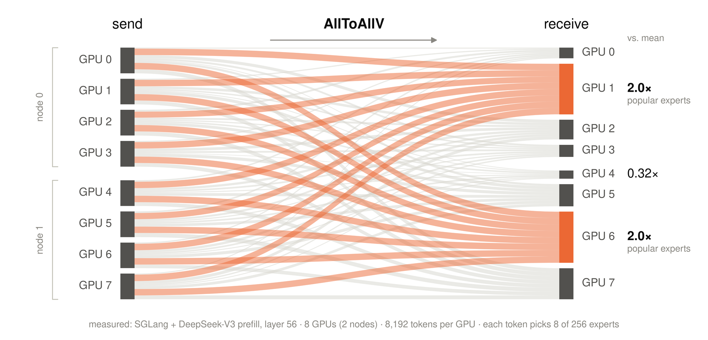
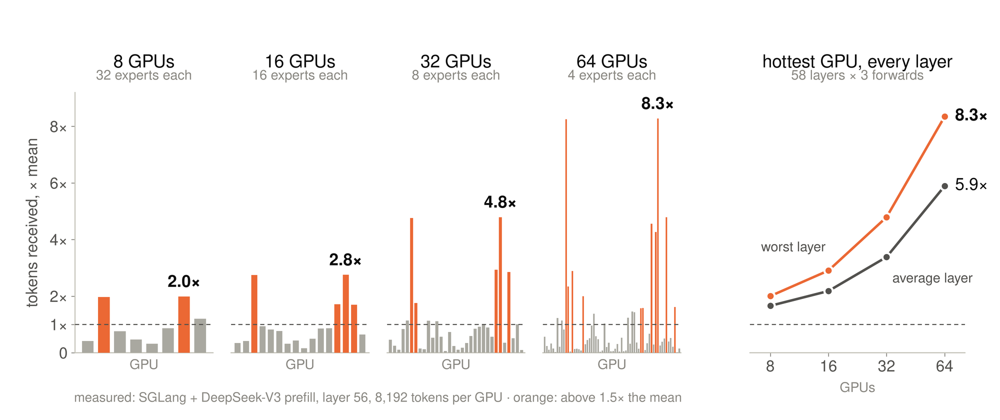
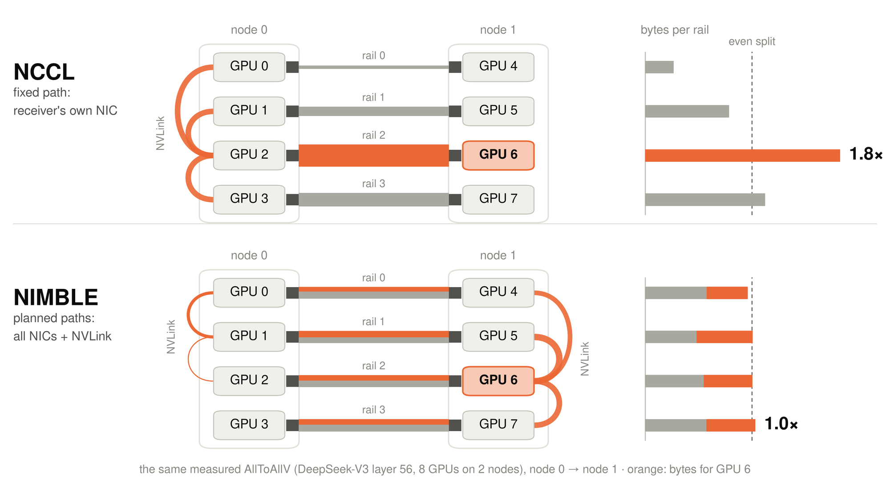
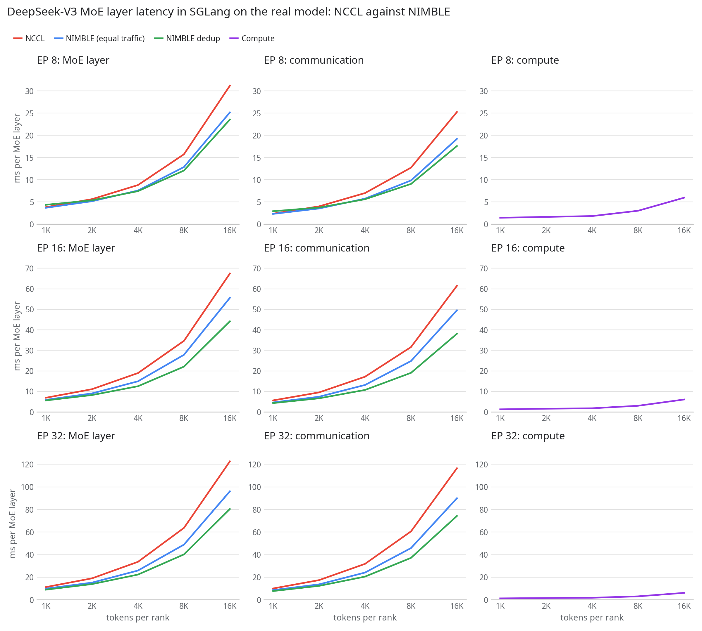
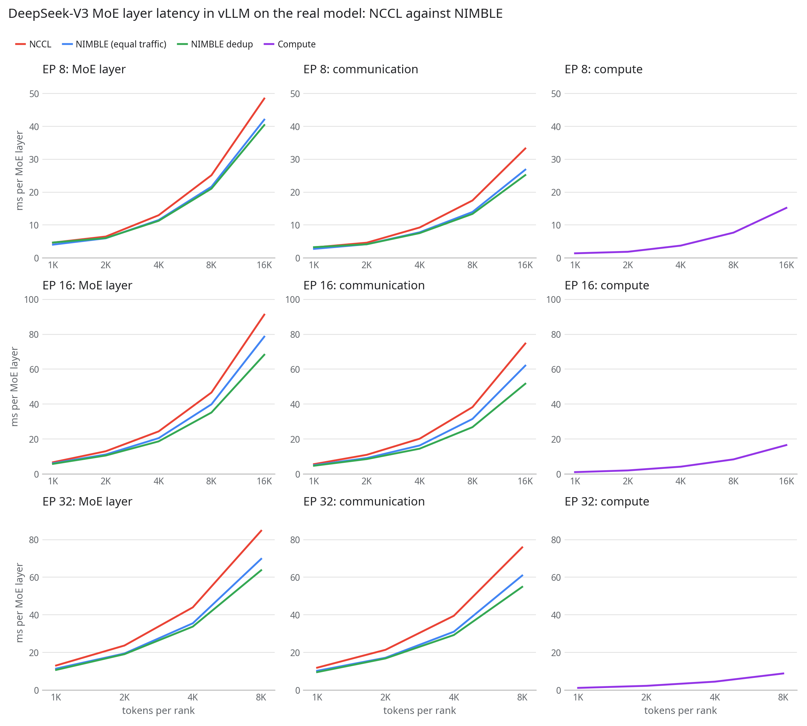

# NIMBLE v1

GPU AllToAllV for irregular traffic, with an MoE dispatcher for SGLang and vLLM.

> NIMBLE started as the system of our IPDPS 2026 paper, *From Skew to Symmetry: Node-Interconnect Multi-Path Balancing
> with Execution-time Planning for Modern GPU Clusters*: [arXiv:2604.00317](https://arxiv.org/abs/2604.00317).

NIMBLE plans each AllToAllV from the byte matrix every rank passes: which bytes go directly and which are relayed
through another GPU of the node onto a less loaded NIC. One kernel per call on each GPU moves the data, and one CPU
thread per NIC posts the RDMA writes. It is built for the traffic a fixed-path AllToAll handles worst: a hot receiver,
one heavy pair, skewed MoE routing, large same-node transfers. No user buffer registeration needed!

## Why NIMBLE

In an MoE layer every GPU sends about the same amount, but tokens crowd onto the GPUs that hold popular experts. In this
measured DeepSeek-V3 layer (SGLang prefill, 8 GPUs on 2 nodes), GPUs 1 and 6 receive 2.0x the mean and GPU 4 0.32x.



The skew grows with the number of GPUs. In this layer the hottest GPU receives 2.0x the mean at 8 GPUs and 8.3x at 64
(averaged over all 58 layers: 1.7x and 5.9x).



From node 0 to node 1, NCCL moves the bytes for each GPU through that GPU's own NIC, so all of GPU 6's bytes cross
rail 2: 1.8x the even split. NIMBLE plans the same AllToAllV over every rail and NVLink, and every rail carries
0.96-1.03x of the even split.



## In SGLang and vLLM

`nimble.moe.Dispatcher` runs MoE dispatch and combine over the AllToAllV, and `nimble.integrations` plugs it into
SGLang and vLLM. The charts time DeepSeek-V3's MoE layer on the real model at EP 8, 16 and 32 (2, 4 and 8 GB200 NVL4
nodes): the whole layer, its communication (dispatch and combine) and its compute, which is the same for all three.

- **NCCL**: the same dispatcher over `all_to_all_single` on NCCL, so only the transport differs.
- **NIMBLE (equal traffic)**: the fused mode, one AllToAllV per direction, moving the same bytes as NCCL.
- **NIMBLE dedup**: a token crosses the network to a node once and fans out there over NVLink.

### SGLang



At 16K tokens per rank the MoE layer is 1.21-1.28x faster with NIMBLE than with NCCL, and 1.32-1.53x with dedup
(EP 32: 122.7 ms with NCCL, 96.1 ms with NIMBLE, 80.4 ms with dedup). Only dedup's smallest batch at EP 8 is slower
(1K tokens: 4.36 against 3.83 ms).

Run it:

- [sglang_server.sh](examples/serving/sglang_server.sh): SGLang's server with `--moe-a2a-backend nimble` on every GPU
  of the allocation, then [client.py](examples/serving/client.py) against it (`MODE=dedup` for dedup).
- [sglang_offline.sh](examples/serving/sglang_offline.sh) with [sglang_offline.py](examples/serving/sglang_offline.py):
  SGLang's offline engine, `sglang.Engine`, without an HTTP server.

### vLLM



NIMBLE is faster than NCCL at every batch and EP size, 1.09-1.24x on the layer, and dedup reaches 1.20-1.34x at the
largest batches. The gains are smaller than in SGLang because vLLM's expert kernel runs untuned at large batches, so
compute is a larger share of the layer. EP 32 stops at 8K tokens per rank, a vLLM start-up limit.

Run it:

- [vllm_server.sh](examples/serving/vllm_server.sh): vLLM's server with `--all2all-backend nimble`, one data-parallel
  engine per GPU, then [client.py](examples/serving/client.py) against it (`MODE=dedup` for dedup).

Both frameworks take NIMBLE's backends through a small patch, in the release's `nimble_frameworks-1.0.0.tar.gz` and in
[tools/sglang_ep/setup](tools/sglang_ep/setup) and [tools/vllm_ep/setup](tools/vllm_ep/setup). The steps are in the
[serving guide](docs/python_usage.md#serving-sglang-and-vllm), and every path the examples use is in
[site_env.sh](examples/serving/site_env.sh).

## User APIs

**Install** the wheel from the release's assets (Linux aarch64 with glibc 2.28 or later, Python 3.10-3.15, 4 GPUs per
node, the NVIDIA driver and rdma-core):

```bash
pip install nimble_gpu-1.0.0-py3-none-manylinux_2_28_aarch64.whl
```

### Python: `nimble`

Each example runs with `torchrun --nproc-per-node 4 FILE` on one node, or `sbatch -N NODES launch_slurm.sh FILE` on
several ([launch_slurm.sh](examples/python/launch_slurm.sh)).

| API | what it does | use case |
|---|---|---|
| `nimble.init(...)` | creates a communicator (collective), over a `torch.distributed` group or from the environment | [quickstart](examples/python/01_all_to_all_single.py), [subgroups](examples/python/04_subgroups.py), [without torch.distributed](examples/python/05_no_torch_distributed.py) |
| `nimble.all_to_all_single(output, input, output_split_sizes, input_split_sizes)` | a drop-in for `torch.distributed.all_to_all_single` | [quickstart](examples/python/01_all_to_all_single.py) |
| `nimble.alltoallv(output, input, output_split_sizes, input_split_sizes, matrix=rows, stream=s)` | the AllToAllV, given the count table every rank already holds | [count table](examples/python/02_alltoallv_counts.py), [streams](examples/python/03_streams.py) |
| `comm.alltoallv_bytes(send_ptr, recv_ptr, byte_matrix, stream)` | the same on raw device pointers (CuPy, JAX, any allocator) | [without torch.distributed](examples/python/05_no_torch_distributed.py) |
| `nimble.NimbleError`, `comm.async_error()`, `comm.raise_async_error()`, `comm.abort()` | errors, asynchronous failures, abort | [errors](examples/python/06_errors.py) |
| `nimble.destroy()`, `comm.destroy()` | shuts a communicator down (collective) | [quickstart](examples/python/01_all_to_all_single.py), [subgroups](examples/python/04_subgroups.py) |
| `nimble.version_string()`, `nimble.__version__` | the library's and the package's versions | [quickstart](examples/python/01_all_to_all_single.py) |
| `nimble.dedup` | the caller's side of the MoE dedup call | [reference](docs/python_api.md#the-moe-dedup-call) |

### MoE: `nimble.moe` and `nimble.integrations`

| API | what it does | use case |
|---|---|---|
| `Dispatcher(group, comm=, num_experts=, hidden_size=, topk=, ..., mode=, transport=)` | MoE dispatch and combine; `mode="fused"` or `"dedup"`, `transport="nimble"` or `"torch"` (NCCL) | [MoE dispatcher](examples/python/07_moe_dispatcher.py) |
| `dispatcher.dispatch(x, x_scales, topk_ids, topk_weights)` | sends each token to the ranks that hold its top-k experts | [MoE dispatcher](examples/python/07_moe_dispatcher.py) |
| `dispatcher.combine(expert_rows, handle)` | returns each token's sum over those ranks | [MoE dispatcher](examples/python/07_moe_dispatcher.py) |
| `nimble.integrations.sglang` | SGLang's `--moe-a2a-backend nimble` (and `nccl_a2a`) | [sglang_server.sh](examples/serving/sglang_server.sh), [sglang_offline.py](examples/serving/sglang_offline.py) |
| `nimble.integrations.vllm` | vLLM's `--all2all-backend nimble` (and `nccl_a2a`) | [vllm_server.sh](examples/serving/vllm_server.sh) |

Every use case step by step: [docs/python_usage.md](docs/python_usage.md). Every argument:
[docs/python_api.md](docs/python_api.md).
